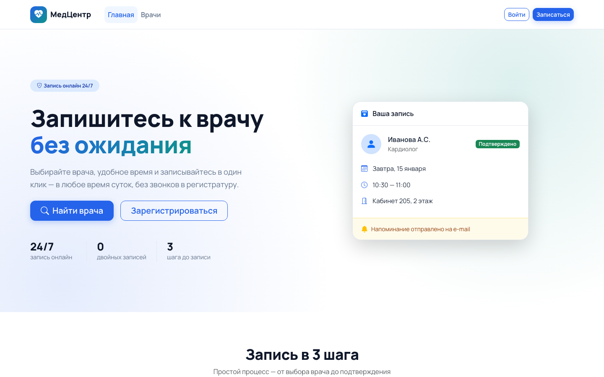
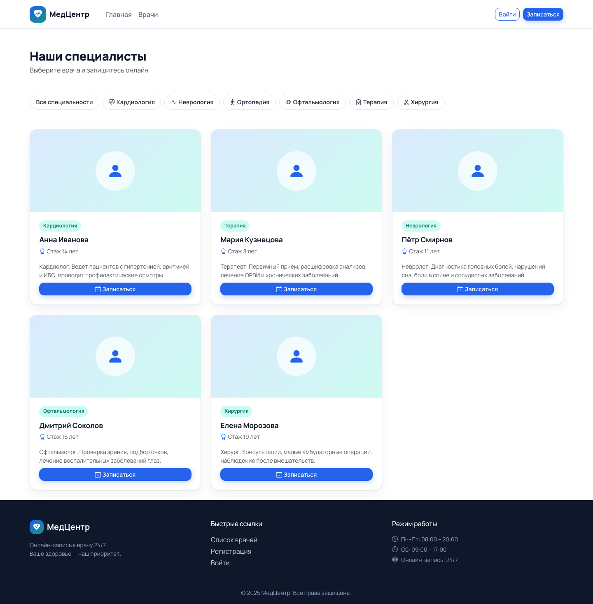
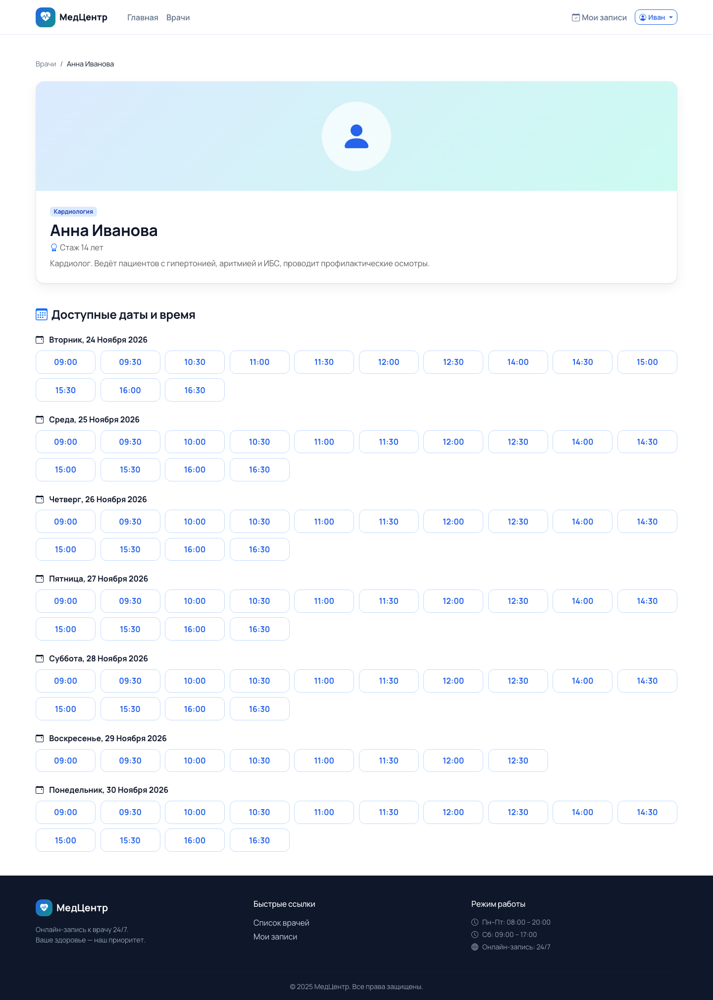
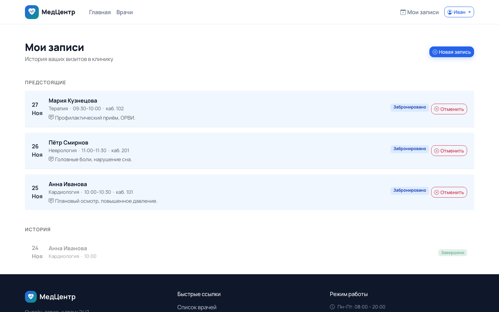
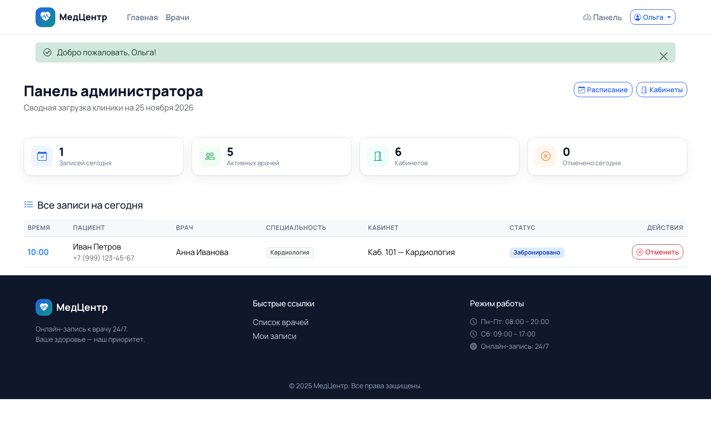
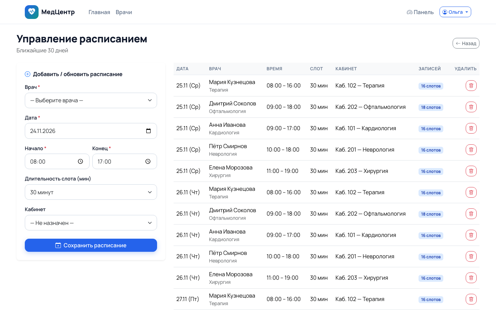
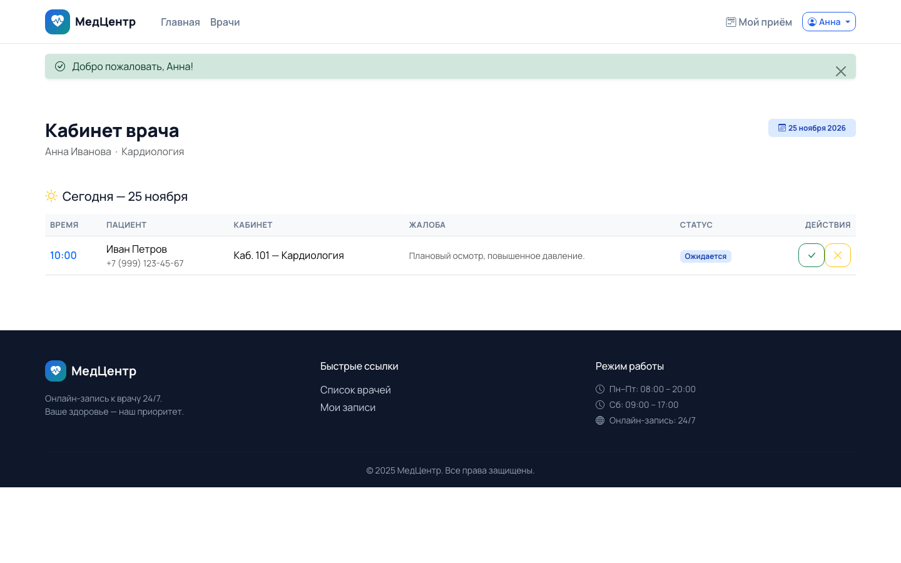

# МедЦентр — онлайн-запись в медицинский центр

Веб-приложение для записи пациентов к врачам: расписание, свободные слоты, бронирование, кабинеты врача и администратора, e-mail-уведомления.

Репозиторий: https://github.com/TR-Artem/medical_booking



## Возможности

**Пациент**
- регистрация, вход по логину или e-mail, сброс пароля;
- личный профиль и смена пароля;
- выбор врача по специальности и поиск;
- свободные слоты на 7 дней вперёд, прошедшее время скрыто;
- бронирование без двойных записей (транзакция + `select_for_update`);
- повторная запись на слот после отмены;
- список своих записей и отмена.

**Врач**
- записи на сегодня и ближайшие 14 дней;
- подтверждение записи, отметка явки / неявки пациента;
- блокировка слота (отпуск, учёба).

**Администратор клиники**
- записи на сегодня и статистика;
- управление расписанием врачей (слоты генерируются автоматически);
- проверка конфликтов кабинета и времени;
- управление кабинетами;
- отмена записи пациента.

**Системный администратор**
- управление пользователями: создание, роли, редактирование, блокировка;
- доступ к Django admin (у администратора клиники его нет).

**Уведомления**
- письмо-подтверждение при записи и отмене;
- напоминание за 24 часа через Celery Beat (задача создаётся миграцией);
- отправка через Celery с повторами при ошибке SMTP;
- Mailpit для демо: письма видны на http://localhost:8025, наружу не уходят.

## Стек

- Python 3.12, Django 5.2
- PostgreSQL 16, Redis 7, Celery + django-celery-beat
- Bootstrap 5, собственные CSS/JS, без фронтенд-сборки
- Gunicorn + Nginx, Docker Compose
- Ruff, Black, Django TestCase, GitHub Actions

## Быстрый старт (Docker)

Требуется Docker Desktop / OrbStack с Docker Compose v2.

```bash
git clone https://github.com/TR-Artem/medical_booking.git
cd medical_booking

make setup      # создать .env и собрать образы
make run        # поднять контейнеры, применить миграции, собрать статику
make seed-dev   # демо-данные: пользователи, врачи, расписание, записи
```

Открыть: **http://localhost:8080**<br>
Письма демо-стенда: **http://localhost:8025** (Mailpit).

Без Makefile:

```bash
cp .env.example .env
docker compose up --build -d
docker compose exec web python manage.py migrate
docker compose exec web python manage.py seed_demo
```

## Демо-доступы

Создаются командой `seed_demo`. Пароль у всех учёток — `Test1234!`.
В поле «Логин или e-mail» вводится логин целиком (он совпадает с e-mail).

| Роль | Логин | Куда попадает после входа |
|---|---|---|
| Администратор клиники | `admin@test.ru` | `/appointments/admin/dashboard/` |
| Системный администратор | `sysadmin@test.ru` | `/appointments/admin/users/`, Django admin |
| Врач-кардиолог | `doctor@test.ru` | `/appointments/doctor/dashboard/` |
| Врачи других специальностей | `doctor2@test.ru` … `doctor5@test.ru` | кабинет врача |
| Пациент | `patient@test.ru` | главная, «Мои записи» |

> Пароли демо-учёток сбрасываются при каждом запуске `seed_demo`. На реальном стенде смените их или не запускайте команду.

## Команда seed_demo

Создаёт полный демонстрационный набор и не требует `loaddata`:

- 6 специальностей и 6 кабинетов;
- администратора, системного администратора, 5 врачей с профилями, пациента;
- расписание всех врачей на 7 дней вперёд (09:00–19:00 по графикам, обед заблокирован, воскресенье — короткий день);
- 3 записи пациента: сегодня, завтра и через два дня.

```bash
python manage.py seed_demo                  # 7 дней, пароль Test1234!
python manage.py seed_demo --days 14        # расписание на 14 дней
python manage.py seed_demo --password 'ДругойПароль1!'
python manage.py seed_demo --without-appointments
python manage.py seed_demo --keep-legacy    # не удалять старые учётки @medcenter.local
```

Команда идемпотентна: повторный запуск обновляет данные и не создаёт дубликатов. Активные демо-записи пациента пересоздаются, прошедшие помечаются завершёнными. Старые демо-учётки от `create_demo_data` (`@medcenter.local`) удаляются автоматически, чтобы в списке врачей не было дублей.

## Production-стенд

```bash
cp .env.production.example .env.production
# заполнить SECRET_KEY и DB_PASSWORD

make deploy     # сборка, миграции, статика
make seed       # демо-данные
```

Открыть: **http://localhost**

Проверка: `make check-deploy` — статус сервисов, логи, HTTP-код.

## VPS с HTTPS

Скрипт `deploy/setup-vps.sh` разворачивает проект на чистом Ubuntu/Debian VPS: Docker, код, `.env.production`, Let's Encrypt, Nginx с HTTPS, миграции, демо-данные, cron для перезагрузки Nginx после продления сертификата.

Перед запуском:

1. A-запись домена указывает на IP сервера.
2. Порты 80 и 443 свободны.

```bash
DOMAIN=clinic.example.ru EMAIL=admin@example.ru bash deploy/setup-vps.sh
```

Скрипт использует:

- `deploy/nginx-https.conf.template` — HTTP→HTTPS, ACME-челлендж, HSTS, проксирование;
- `deploy/docker-compose.https.yml` — порты 80/443, сертификаты, контейнер продления Certbot.

Ручной запуск после выпуска сертификата:

```bash
make deploy-https
```

Файл `.env.production` для HTTPS должен содержать:

```dotenv
ALLOWED_HOSTS=clinic.example.ru
CSRF_TRUSTED_ORIGINS=https://clinic.example.ru
SITE_URL=https://clinic.example.ru
SESSION_COOKIE_SECURE=True
CSRF_COOKIE_SECURE=True
SECURE_SSL_REDIRECT=True
SECURE_HSTS_SECONDS=31536000
```

Django получает исходную схему из `X-Forwarded-Proto`, поэтому редиректа-петли за Nginx нет.

## Скриншоты

| Врачи и специальности | Свободные слоты |
|---|---|
|  |  |

| Записи пациента | Панель администратора |
|---|---|
|  |  |

| Управление расписанием | Кабинет врача |
|---|---|
|  |  |

## Структура проекта

```text
medical_booking/
├── manage.py
├── medical_booking/              # настройки Django
├── apps/
│   ├── accounts/                 # пользователи, роли, профили врачей, вход
│   ├── appointments/             # специальности, кабинеты, расписание, слоты, записи
│   ├── notifications/            # e-mail-уведомления и задачи Celery
│   └── core/                     # главная страница, seed_demo
├── templates/                    # шаблоны: пациент, врач, админ, сисадмин
├── static/                       # CSS, JS, favicon
├── fixtures/initial_data.json    # справочники (специальности, кабинеты)
├── deploy/                       # VPS: HTTPS, compose-оверрайд, setup-vps.sh, backup.sh
├── docs/                         # отчёты, инструкции, screenshots
├── scripts/                      # BAT-скрипты для Windows
├── tests/                        # smoke/API/load-проверки и Playwright E2E
├── Dockerfile
├── docker-compose.yml            # разработка: 8080, код монтируется
├── docker-compose.prod.yml       # production: только 80, код в образе
├── Makefile
└── README.md
```

## Команды

| Действие | Команда |
|---|---|
| Запуск dev-стенда | `make run` → http://localhost:8080 |
| Демо-данные | `make seed-dev` |
| Линтер, форматтер, тесты | `make check` |
| Production-стенд | `make deploy` → http://localhost |
| Демо-данные на production | `make seed` |
| HTTPS на VPS | `bash deploy/setup-vps.sh` |
| Health-check | `make health` → `/healthz/` |
| Статус и логи | `make check-deploy` |
| Бэкап / восстановление БД | `make backup`, `make restore BACKUP=...` |
| Остановка | `make docker-down` |

## Тесты и качество

```bash
make check       # ruff + black --check + 75 тестов
make format      # автоформатирование
```

CI: `.github/workflows/ci.yml` — линтер, форматтер, `manage.py check --deploy`,
миграции, юнит-тесты, `pip-audit`, Playwright E2E и smoke-сборка Docker-стека.

## Мониторинг и бэкапы

- `/healthz/` — JSON со статусом приложения, БД и версией; 503 при недоступной БД.
- `deploy/backup.sh` — ежедневный `pg_dump` с ротацией (14 дней по умолчанию),
  на VPS ставится в cron скриптом `setup-vps.sh`.
- Логи контейнеров ограничены 10 МБ × 3 файла (json-file driver).

## Ограничения демо

- Медцентр один; мультиклиничность и филиалы не поддерживаются.
- Нет онлайн-оплаты, медицинской карты и интеграции с внешними МИС.
- Демо-письма складываются в Mailpit; для реальной отправки нужен SMTP-провайдер.
- Демо-пароль `Test1234!` публичный: для реальной эксплуатации задайте свои пароли и не запускайте `seed_demo` на проде.
- Rate limit входа общий для всех воркеров через Redis. При недоступном Redis
  защита отключается, чтобы не блокировать вход.

## Документация

- [INSTALL.md](INSTALL.md) — установка, команды, проверка сервисов.
- [docs/DEPLOYMENT.md](docs/DEPLOYMENT.md) — локальный production-стенд и VPS с HTTPS.
- [docs/DEMO_GUIDE.md](docs/DEMO_GUIDE.md) — сценарий демонстрации.
- [docs/CONFIGURATION.md](docs/CONFIGURATION.md) — переменные окружения.
- [docs/TEST_PLAN.md](docs/TEST_PLAN.md) — план тестирования.
- [SECURITY.md](SECURITY.md) — меры безопасности.
